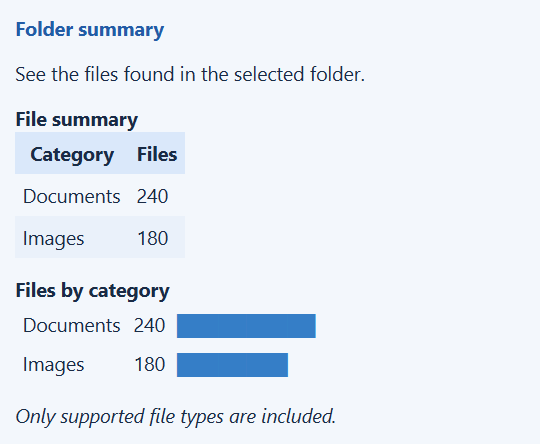

# Qt Tooltip Kit

A header-only C++17 library for Qt 6 Widgets. It supports plain widgets and
actions exposing a widget-configuration callback. It has no ManiVault dependency.

## Preview

## CMake

Publish this folder as the root of a repository. Place a checkout named
qt-tooltip-kit beside the plugin source directories for offline builds, or
configure the plugins with:

    -DQT_TOOLTIP_KIT_REPOSITORY=https://github.com/sbvis/qt-tooltip-kit.git
    -DQT_TOOLTIP_KIT_REVISION=FULL_COMMIT_SHA

For other projects, use add_subdirectory or FetchContent, then link
`QtTooltipKit::Tooltips`. The target exposes QtTooltipKit.h.

## Usage

    #include <QtTooltipKit.h>

    using namespace QtTooltipKit::Tooltips;
    Options options;
    options.widthPixels = 380;
    options.fontPoints = 11;
    options.durationMs = 15000;
    options.accent = QColor("#357ec7");
    options.sections = {{ "Inputs", { "Uses the files in the selected folder." } }};
    options.tables = {{ "Summary", { "Category", "Files" }, {{ "A", "240" }} }};
    options.charts = {{ "Files by category", { "A", "B" }, { 240, 180 } }};
    options.shortcut = "Ctrl+Enter";
    options.note = "Only supported file types are included.";
    set(widget, "Update", "Refresh the file summary.", options);

Defaults are 320 pixels, 10 points, and a long display duration. Qt dismisses
the tooltip when the pointer leaves. Text is escaped and line breaks are
preserved. Tables and charts are capped per block by maxRows (default 12).
Charts are static bars scaled to the largest absolute value in the displayed
data. The value column retains the sign. Nonfinite values are skipped.
Call markup to get rich text without attaching it to a control.

## Tests

    cmake -S . -B build -DQT_TOOLTIP_KIT_BUILD_TESTS=ON
    cmake --build build --config Release
    ctest --test-dir build -C Release --output-on-failure

## License

Apache License 2.0. See [LICENSE](LICENSE).
### Appearance

By default the tooltip inherits the Qt theme. Set `background`, `foreground`,
and `accent` for a custom palette. Use `paddingPixels`, `tableCellPadding`,
`tableBorders`, `tableHeaderBackground`, and `alternateRowBackground` to
adjust spacing and table presentation. Each bar chart can set its own color.

## Interactive popups

Include <QtTooltipKitPopup.h> and attach a popup to a widget:

    auto* panel = new QWidget;
    auto* layout = new QVBoxLayout(panel);
    layout->addWidget(new QLabel("Folder summary"));
    layout->addWidget(new QPushButton("Refresh"));
    qttooltipkit::PopupOptions options;
    options.placement = qttooltipkit::Placement::Right;
    options.alignment = qttooltipkit::Alignment::Start;
    options.hoverDelayMs = 400;
    new qttooltipkit::Popup(anchor, panel, options);

The anchor owns the popup, which owns its content. Use any QWidget-based
layout, including a custom chart or an optional QWebEngineView supplied by
the application for modern HTML and CSS. Native rich tooltips use Qt's rich
text subset. Popup content can also use Qt widget stylesheets.

The popup supports delayed hover entry and exit, fade-in, four placement
directions, alignment, and optional pointer indicators. It flips or clamps
to the anchor monitor's usable area. On Wayland it uses a child overlay
bounded by the anchor window. Keyboard focus behavior depends on the window
system. Screen placement and interaction should be tested on target platforms.
